# Trabalho 3 — Persistência com Room · Gym

Documentação do processo e das decisões do trio. Para rodar o projeto, veja o [README](README.md).
A história dos trabalhos anteriores está em [DOCUMENTACAO.md](DOCUMENTACAO.md) (Trabalho 2).

**Integrantes:** ✏️ _preencher_

▶ **[Vídeo do teste de persistência](docs/videos/t3-teste-persistencia.mp4)** (66 s): adicionar um
exercício, fechar o app pela tela de recentes, abrir de novo e o exercício continuar lá.

---

## Onde está cada requisito

| Requisito | Onde |
|---|---|
| Dependências do Room (`room-runtime`, `room-ktx`, KSP `room-compiler`) | `gradle/libs.versions.toml`, `build.gradle.kts` e `app/build.gradle.kts` |
| 2 `@Entity` com `@PrimaryKey(autoGenerate = true)` | `WorkoutTemplate` (tabela `treinos`) e `Exercise` (tabela `exercicios`), em `data/Models.kt` |
| 2 `@Dao` com `@Insert`, `@Query`, `@Update`, `@Delete`, todos `suspend` | `data/WorkoutTemplateDao.kt` e `data/ExerciseDao.kt` |
| Consulta filtrada por campo | `buscarPorId(id)` nos dois DAOs: `SELECT * FROM ... WHERE id = :id` |
| `AppDatabase` em Singleton (`companion object` + `@Volatile` + `synchronized`) | `data/AppDatabase.kt` |
| Listas buscam do banco ao abrir (`LaunchedEffect(Unit)`) | `WorkoutsScreen.kt` e `ProgressScreen.kt` chamam `viewModel.carregar()`, que usa `buscarTodos()` |
| Inserir pela UI | Treinos: formulário **Novo treino**. Exercícios: formulário do **+** em Progresso |
| Atualizar pela UI | Treinos: **lápis** no detalhe abre **Editar treino**. Exercícios: **Registrar carga** no detalhe |
| Remover pela UI | Treinos: lixeira no card. Exercícios: toque longo no card |
| Detalhe lendo do banco pelo id | Os dois: `workouts/{templateId}` e `progress/{exerciseId}` usam `buscarPorId` |
| Toda operação de banco numa coroutine em `Dispatchers.IO` | Escritas: `CoroutineScope(Dispatchers.IO).launch { }`. Leituras: `withContext(Dispatchers.IO)` dentro do `carregar()` |
| `try/catch` com `Log.e` | Em toda operação de banco, com a tag `GymDb` (filtre por ela no Logcat) |

---

## 1. Como estava no Trabalho 2 e o que mudou

No Trabalho 2, as duas listas (treinos e exercícios) eram `mutableStateListOf` dentro do
`FakeRepository`, um `object`. Adicionar, remover e registrar carga funcionavam, e a mudança
aparecia em todas as telas, mas tudo vivia na memória: fechar o app voltava ao estado inicial.

Agora as duas listas são duas tabelas de um banco SQLite, acessadas pelo Room:

| | Trabalho 2 | Trabalho 3 |
|---|---|---|
| Onde ficam os dados | `mutableStateListOf` no `FakeRepository` | tabelas `treinos` e `exercicios` no arquivo `gym.db` |
| Id dos itens | `String` escolhida à mão (`"push-a"`) | `Int` gerado pelo banco (`autoGenerate = true`) |
| Como a tela lê | lê a lista do repositório durante a composição | `LaunchedEffect(Unit)` → `carregar()` → `dao.buscarTodos()` |
| Detalhe | `FakeRepository.templateById(id)` | `dao.buscarPorId(id)` |
| Editar um treino | não existia | lápis no detalhe → **Editar treino** → `dao.atualizar(...)` |
| Fechar o app | perde tudo | os dados continuam lá |

O `FakeRepository` continua existindo, mas mudou de papel. Ele guarda só os dados de exemplo com
que o banco nasce (`seedExercises` e `seedTemplates`), os textos fixos do Perfil e da Início, e as
funções que cruzam as duas tabelas, como `exercisesOf(treino, exercícios)`.

| Lista vinda do banco | Exercício inserido | Carga registrada (`atualizar`) |
|---|---|---|
|  | 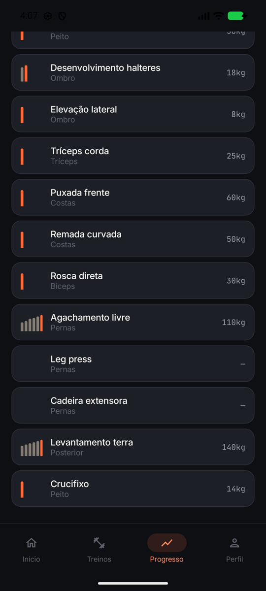 |  |

---

## 2. Entity, DAO e Database

### As duas `@Entity`

Reaproveitamos as duas data classes do Trabalho 2. Elas são os dois tipos de item que existem no
domínio do app: o **treino** (a ficha: Push A, Legs…) e o **exercício** (Supino reto, Agachamento…).

```kotlin
@Entity(tableName = "treinos")
data class WorkoutTemplate(
    @PrimaryKey(autoGenerate = true) val id: Int = 0,
    val name: String,
    val exerciseIds: List<Int>,
    val notes: String = "",
)

@Entity(tableName = "exercicios")
data class Exercise(
    @PrimaryKey(autoGenerate = true) val id: Int = 0,
    val name: String,
    val muscleGroup: String,
    val history: List<LoadEntry> = emptyList(),
)
```

**Por que esses campos.** São exatamente os campos que as telas já usavam no T2.

- **Treino:** `name` e `notes` vêm do formulário. `exerciseIds` guarda só os ids dos exercícios,
  não cópias deles. Assim, nome, grupo muscular e última carga vêm sempre da tabela de exercícios,
  e as duas tabelas nunca discordam.
- **Exercício:** `name` e `muscleGroup` aparecem no card. `history` é a lista de cargas
  (`data`, `peso`, `reps`), da mais recente para a mais antiga. Recorde, gráfico e 1RM estimado
  **não** viraram colunas: são calculados a partir do histórico (`get()` sem campo guardado). Por
  isso nunca ficam desatualizados, e o Room ignora essas propriedades.

**Listas dentro de uma coluna.** Uma coluna do SQLite só guarda tipos simples (texto, número).
Para as duas listas, criamos uma classe `Converters` com `@TypeConverter`, registrada no
`@Database` com `@TypeConverters(Converters::class)`:

| Campo | No Kotlin | Na coluna |
|---|---|---|
| `exerciseIds` | `listOf(1, 2, 5)` | `1,2,5` |
| `history` | `listOf(LoadEntry("18 ago", 80.0, 8), ...)` | `18 ago;80.0;8\|14 ago;75.0;10` |

Pensamos em criar uma terceira tabela só para as cargas, com uma chave estrangeira para o
exercício. Mas o histórico é sempre lido e gravado inteiro, junto com o exercício, então o
conversor resolveu com bem menos código.

### Os dois `@Dao`

Um DAO por Entity, com os 4 métodos básicos e uma consulta por id:

```kotlin
@Dao
interface ExerciseDao {
    @Insert suspend fun inserir(exercise: Exercise)

    @Query("SELECT * FROM exercicios ORDER BY id")
    suspend fun buscarTodos(): List<Exercise>

    @Query("SELECT * FROM exercicios WHERE id = :id")
    suspend fun buscarPorId(id: Int): Exercise?

    @Update suspend fun atualizar(exercise: Exercise)
    @Delete suspend fun deletar(exercise: Exercise)
}
```

O `WorkoutTemplateDao` é igual, sobre a tabela `treinos`.

### O `AppDatabase`

`abstract class AppDatabase : RoomDatabase()` com `@Database(entities = [WorkoutTemplate::class,
Exercise::class], version = 1)`, expondo `workoutTemplateDao()` e `exerciseDao()`. O
`getDatabase(context)` segue o Singleton visto em aula: `companion object`, `@Volatile private var
INSTANCE` e `synchronized(this)`, para que o app inteiro use uma conexão só com o `gym.db`.

**O banco nasce com os exemplos do T2.** Sem isso, o app abriria vazio na primeira vez. Um `RoomDatabase.Callback` insere os 12
exercícios e os 4 treinos no `onCreate`, que só roda quando o arquivo do banco é criado. Os
exemplos têm ids fixos (1 a 12), para que os treinos possam apontar para eles.

---

## 3. Como estruturamos as queries

Além dos 4 métodos básicos, cada DAO tem **um** método a mais: `buscarPorId`. Avaliamos outras
consultas e decidimos não criar:

- **`buscarPorId` nos dois DAOs.** A rota dos dois detalhes (`workouts/{templateId}` e
  `progress/{exerciseId}`) leva só o id. O detalhe busca o item certo no banco, em vez de receber o
  objeto pronto. O Treino ativo e o formulário de edição usam a mesma consulta. O retorno é
  anulável (`Exercise?`): se o item foi apagado, a tela mostra "Este exercício não existe mais."
  em vez de quebrar.
- **`ORDER BY id` no `buscarTodos`.** Como os ids são gerados em ordem crescente, a lista sai na
  ordem de criação, igual à `mutableStateListOf` do T2, em que o item novo entrava no fim.
- **Por que não `WHERE id IN (:ids)` para os exercícios de um treino.** O `IN` devolve os
  exercícios na ordem da tabela, não na ordem em que o usuário os escolheu. Seria preciso reordenar
  depois. Buscar todos e filtrar pelos ids do treino (`exercisesOf`) já sai na ordem certa.
- **Remover um exercício que está em treinos.** No T2 o exercício saía também dos treinos que o
  usavam, e mantivemos isso: depois do `deletar`, buscamos os treinos que contêm o id e chamamos
  `atualizar` em cada um, sem aquele id.

---

## 4. A migração de `mutableStateListOf` para Room: o que quebrou e como resolvemos

- **Ids de `String` para `Int`.** O requisito pede `val id: Int = 0` com `autoGenerate`. Os ids do
  T2 eram textos (`"supino-reto"`), e trocar o tipo se espalhou pelo app: rotas, argumentos de
  navegação (`NavType.StringType` → `IntType`), callbacks das telas (`(String) -> Unit` →
  `(Int) -> Unit`) e o `todayTemplateId` da Início. Com o tipo trocado na Entity, o compilador
  aponta cada lugar que ficou para trás.
- **O banco não aceita lista.** O Room não sabe gravar `List<Int>` nem `List<LoadEntry>` numa coluna
  (o build falha com "Cannot figure out how to save this field into database"). Resolvemos com os
  `@TypeConverter` (seção 2).
- **A tela não podia mais ler a lista "na hora".** No T2, o detalhe era um *getter* lido durante a
  composição (`val exercise get() = FakeRepository.exerciseById(id)`). Com o Room, a busca é uma
  função `suspend`, que não pode ser chamada na composição. Cada tela passou a ter um
  `LaunchedEffect(Unit) { viewModel.carregar() }`. Ele roda toda vez que a tela entra em cena,
  inclusive ao voltar de outra tela. É isso que faz a lista mostrar o treino que acabou de ser
  criado, ou o detalhe mostrar a carga nova.
- **A mensagem de "vazio" ia piscar.** Enquanto a primeira busca não termina, a lista estaria vazia
  ("Nenhum treino ainda") e o detalhe diria "Este treino não existe mais.", por uma fração de
  segundo. Para evitar isso, a lista começa como `null` (= ainda buscando) e o detalhe tem um
  `loaded`. A tela só desenha depois da primeira resposta do banco.
- **Salvar e voltar ao mesmo tempo.** O formulário chamava `save()` e logo depois `popBackStack()`.
  Com a gravação assíncrona, a lista poderia buscar os dados antes de o `inserir` terminar, e o
  treino novo não apareceria. Por isso `save(onSaved)` só volta para a tela anterior depois da gravação.
  A gravação usa `CoroutineScope(Dispatchers.IO)`, e não o `viewModelScope`: se a tela fechar no
  meio, o ViewModel é destruído e o `viewModelScope` cancelaria a gravação junto.
- **O Treino ativo não pode recarregar.** Se ele buscasse os dados toda vez que a tela abre, como as
  listas, girar o celular apagaria as séries já marcadas. Ele busca uma vez só, no `init` do ViewModel.
- **O bug que só apareceu testando: o catálogo vazio.** Depois de fechar e reabrir o app, a tela
  Novo treino às vezes abria sem nenhum exercício para escolher, e o treino era salvo vazio. Não
  havia erro no Logcat: a busca funcionava, mas o resultado se perdia. A causa é que o ViewModel é
  criado *durante* a composição da tela. Um `mutableStateOf` criado nesse momento ainda não foi
  "confirmado" pelo Compose, e uma escrita vinda de outra thread (o `Dispatchers.IO`) pode se perder
  se chegar antes dessa confirmação. As outras telas não têm o problema, porque escrevem a partir
  do `LaunchedEffect`, que só roda depois. Trocamos o catálogo para `StateFlow`, que pode ser escrito
  de qualquer thread, como o `uiState` daquela tela já fazia.
- **Os `@Preview` das telas com banco foram removidos.** Os ViewModels agora estendem
  `AndroidViewModel`, porque precisam do `Application` para abrir o banco, e o painel de Preview do
  Android Studio não tem um `Application` para entregar. Mantivemos só o do Perfil, a única tela
  que não usa o banco.
- **O "Treino de hoje" da Início apontava para um treino fixo.** O cartão tinha textos fixos e o
  botão sempre abria o treino de id 1 (o Push A). Com o banco, apagar o Push A deixava o botão
  abrindo um treino vazio para sempre, e editá-lo deixava o "5 exercícios" errado. Como o app não
  tem agenda de treinos, o cartão passou a mostrar o primeiro treino de Meus treinos, lido do banco
  como nas outras telas, e some quando não há nenhum treino.

> ✏️ _Completar com as dificuldades de cada integrante, com as palavras do trio._

---

## 5. Editar um item (o `atualizar` de verdade)

No T2, o lápis de Meus treinos tinha virado lixeira porque não existia edição. Agora o **detalhe
do treino** tem um lápis na barra de cima. Ele abre o mesmo formulário de Novo treino, com o título
**Editar treino**, já preenchido com o que está no banco (`buscarPorId`). Ao salvar, o ViewModel
chama `atualizar` em vez de `inserir`. O formulário sabe qual dos dois chamar pelo id: `0` é treino
novo (o banco gera o id), e qualquer outro valor é edição.

| Detalhe antes | Editar treino | Detalhe depois (recarregado do banco) |
|---|---|---|
| 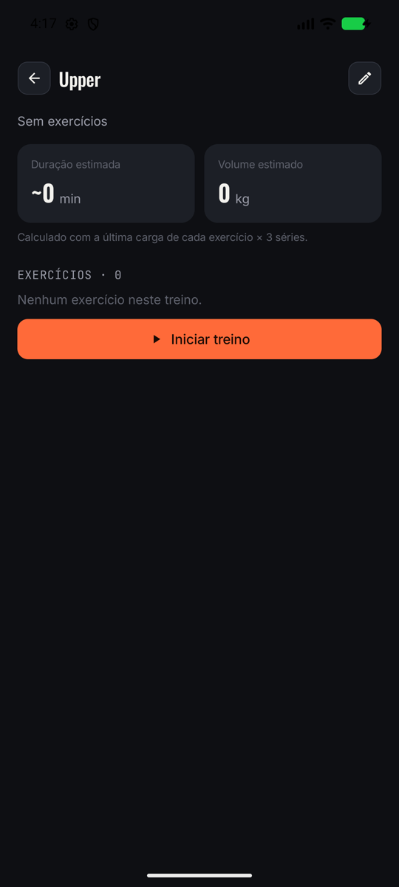 |  | 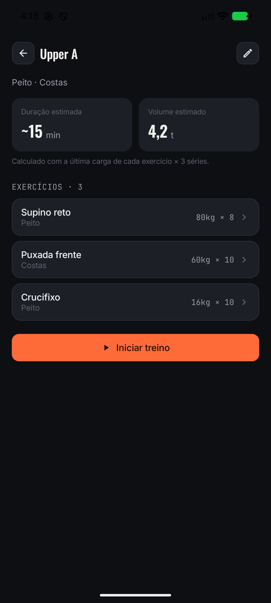 |

Os exercícios também são atualizados: **Registrar carga** no detalhe do exercício coloca a carga
nova no topo do histórico e regrava a linha inteira com `atualizar`.

---

## 6. Teste de persistência

O teste do enunciado: adicionar um item, fechar o app completamente e abrir de novo.
▶ **[Ver o vídeo](docs/videos/t3-teste-persistencia.mp4)**

| 1. "Panturrilha" adicionado | 2. Fechado pela tela de recentes | 3. Reaberto do zero (splash) | 4. Continua na lista | 5. Com a carga |
|---|---|---|---|---|
| 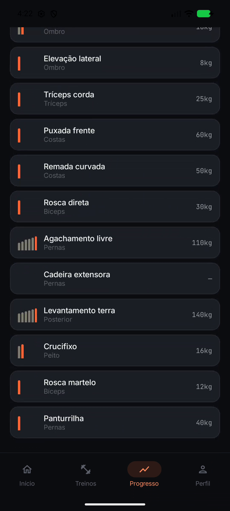 | 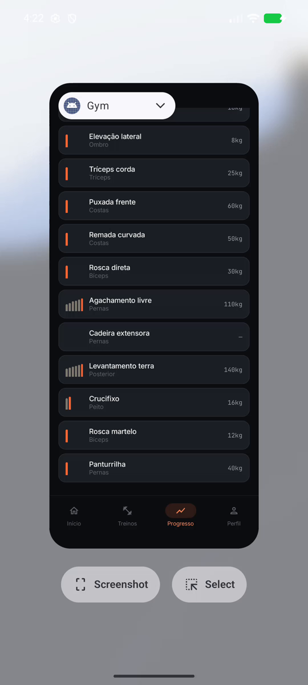 | 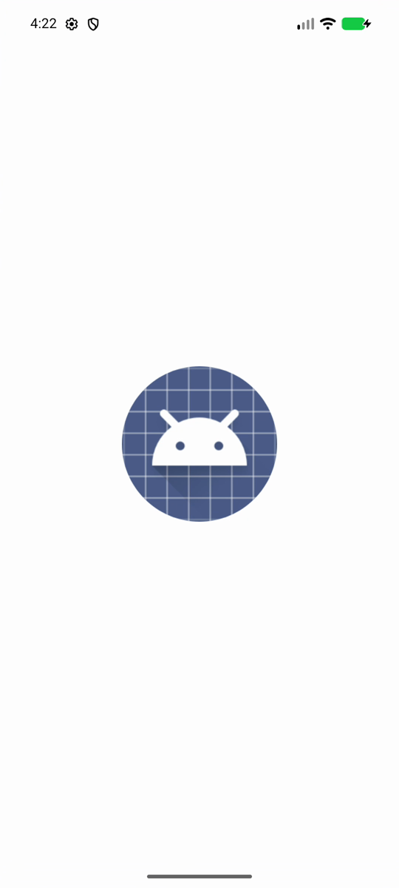 |  | 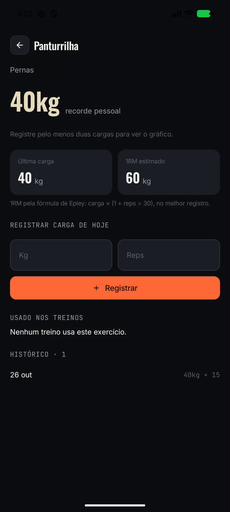 |

A splash screen do passo 3 mostra que o app iniciou do zero, e não só voltou do segundo plano. No
teste, o processo do app trocou de número (PID) entre o antes e o depois.

---

## Galeria: CRUD nas duas listas

**Lista 1 — Treinos**

| Novo treino | Inserido | Confirmar remoção | Removido |
|---|---|---|---|
| 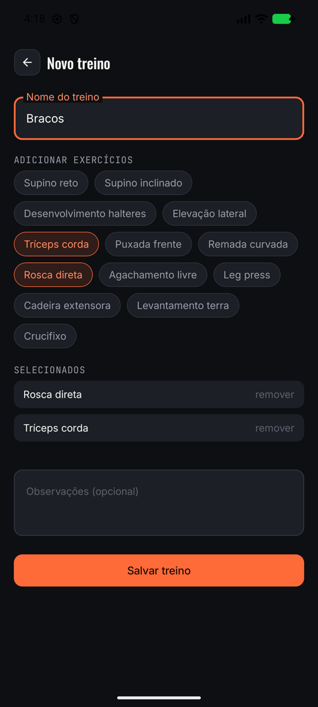 | 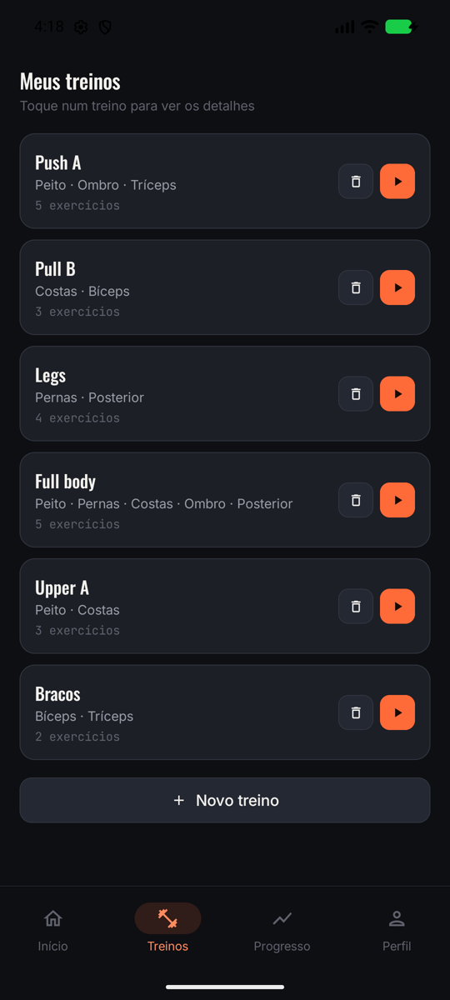 | 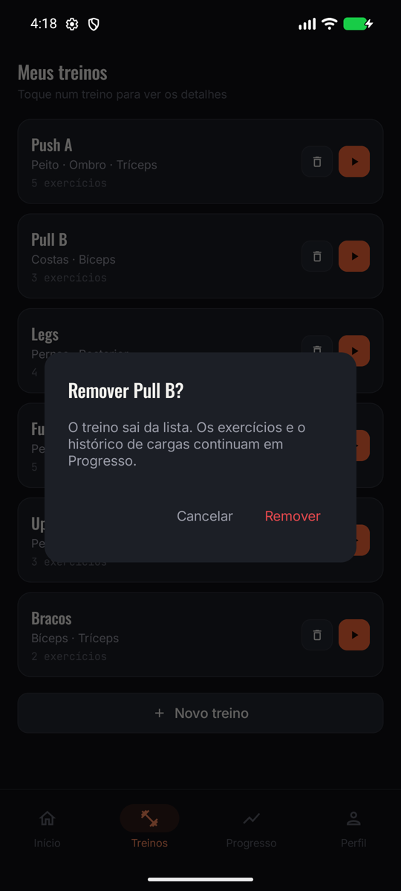 | 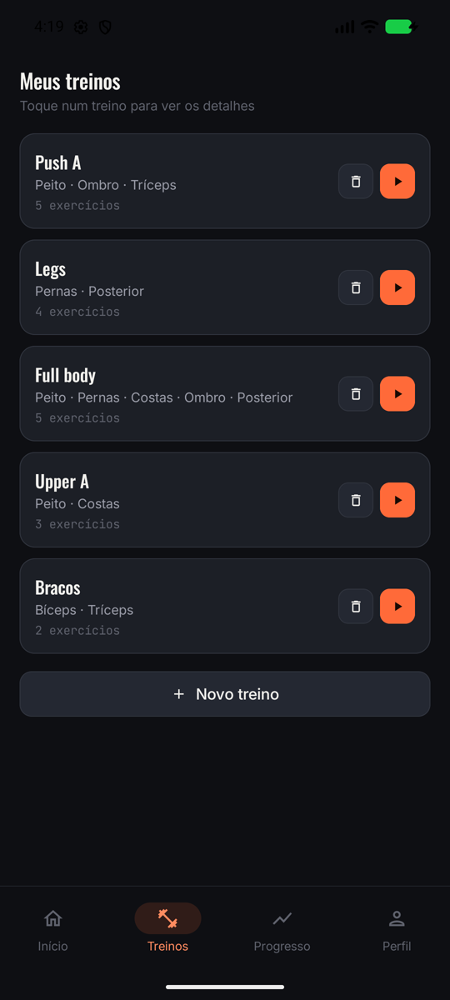 |

**Lista 2 — Exercícios**

| Novo exercício | Inserido (fim da lista) | Carga registrada | Toque longo → remover |
|---|---|---|---|
| 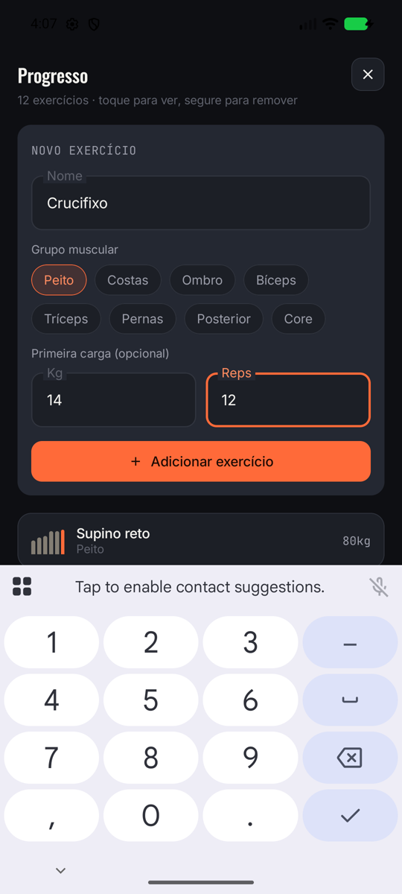 |  |  | 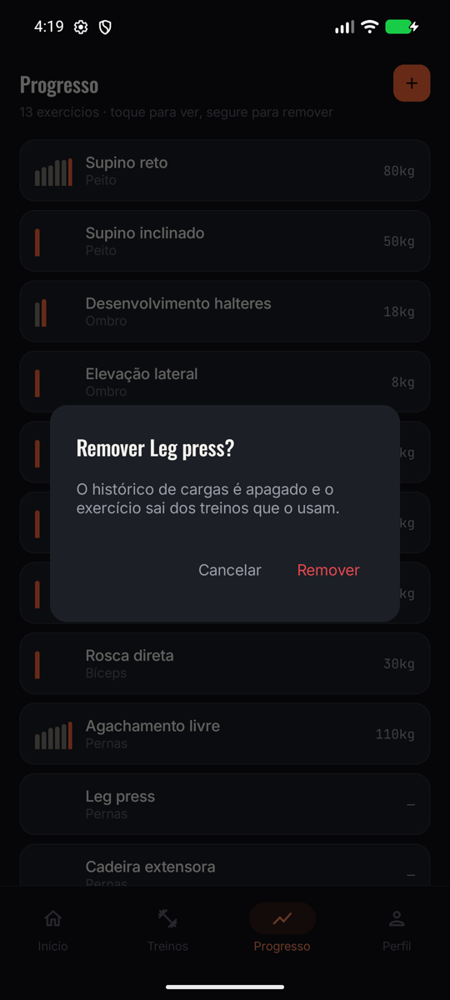 |

O Treino ativo também lê do banco: abrir o "Upper A" traz os 3 exercícios dele, cada um com a
última carga registrada.

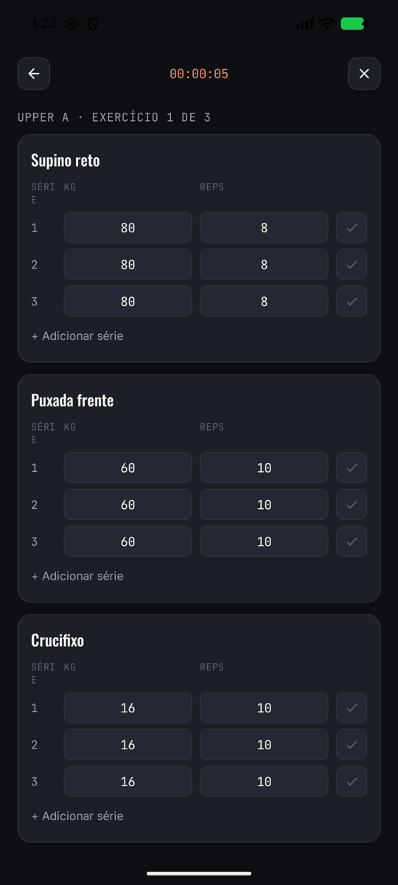

---

## Roteiro da apresentação

1. **Treinos:** mostrar a lista (vem do banco).
2. **Adicionar:** Novo treino → "Upper" com Supino reto e Puxada frente → aparece no fim da lista.
3. **Editar:** abrir o Upper → lápis → renomear para "Upper A" e incluir mais um exercício → salvar.
   O detalhe volta com os dados novos.
4. **Atualizar exercício:** Progresso → Supino reto → registrar 85 kg × 6.
5. **Remover:** lixeira num treino e toque longo num exercício.
6. **Fechar e reabrir:** botão de recentes → arrastar o Gym para cima → abrir pelo ícone. Tudo o que
   foi feito nos passos 2 a 5 continua lá.

Para começar a apresentação do zero, apague os dados do app (Configurações → Apps → Gym →
Armazenamento → Limpar dados). Na próxima abertura, o banco nasce de novo com os exemplos.
