# Trabalho 2 — MAF · Gym

Documentação do processo e das decisões do trio. Para rodar o projeto, veja o [README](README.md).

**Integrantes:** ✏️ _preencher_

---

## Onde está cada requisito

| Requisito | Onde |
|---|---|
| 7+ telas navegáveis | 8 rotas no `NavHost`: Início, Meus treinos, Detalhe do treino, Novo treino, Treino ativo, Progresso, Detalhe do exercício, Perfil |
| `NavHost` central + objeto `Rotas` | `navigation/AppNavigation.kt` e `navigation/Rotas.kt` |
| `NavigationBar` funcionando | `navigation/GymBottomBar.kt` — 4 abas: Início, Treinos, Progresso, Perfil |
| `TopAppBar` com voltar (`popBackStack`) | `ui/components/GymTopBar.kt`, usada em Novo treino, Detalhe do treino e Detalhe do exercício |
| 2 data classes | `WorkoutTemplate` (treino) e `Exercise` (exercício), em `data/Models.kt` |
| 2 listas com `LazyColumn` + `Card` em `mutableStateListOf` | Meus treinos (`feature/workouts/WorkoutsScreen.kt`) e Progresso (`feature/progress/ProgressScreen.kt`); as listas ficam em `data/FakeRepository.kt` |
| Adicionar em cada lista | Treinos: formulário **Novo treino**. Exercícios: formulário que abre no **+** da tela Progresso |
| Remover em cada lista | Treinos: ícone de lixeira no card. Exercícios: toque longo no card (`combinedClickable`). Os dois pedem confirmação |
| 2 telas de Detalhes com o item certo | `workouts/{templateId}` e `progress/{exerciseId}` — a rota leva só o id, e o detalhe busca o item na lista |
| Detalhe que faz mais que reexibir | Os dois — ver [seção 4](#4-a-complexidade-extra-nos-detalhes) |

---

## 1. Como estava no Trabalho 1 e o que mudou

No Trabalho 1 o app já tinha 8 telas e navegação real. Era a tradução para Compose de um protótipo
em HTML que o trio tinha feito antes, e a prioridade foi a fidelidade visual. Os dados, porém, eram
quase todos fixos:

- **Meus treinos** usava `LazyColumn`, mas não dava para remover nada. O botão de lápis abria um
  formulário vazio, não o treino.
- **Progresso** era uma `Column` com 3 exercícios fixos, sem como adicionar ou remover.
- O **Detalhe do exercício** só mostrava os dados. O card "Sessões" exibia o número 18 em qualquer exercício.
- O **Treino ativo** mostrava sempre os mesmos 3 exercícios, qualquer que fosse o treino aberto.
- Não havia `TopAppBar` nem `NavigationBar` do Material: cabeçalho e barra inferior eram
  `Row`s feitas à mão.
- O botão **Sair da conta** do Perfil não fazia nada.

| Treinos · T1 | Treinos · T2 | Progresso · T1 | Progresso · T2 |
|---|---|---|---|
| 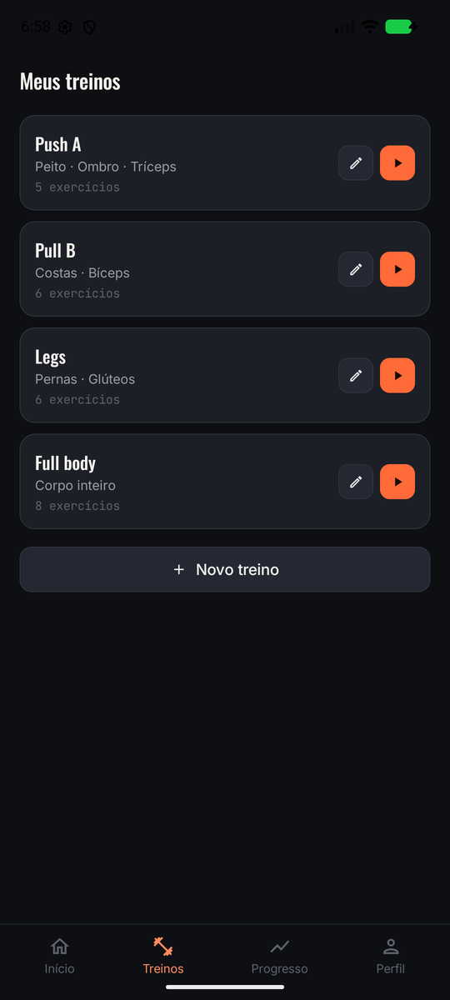 | 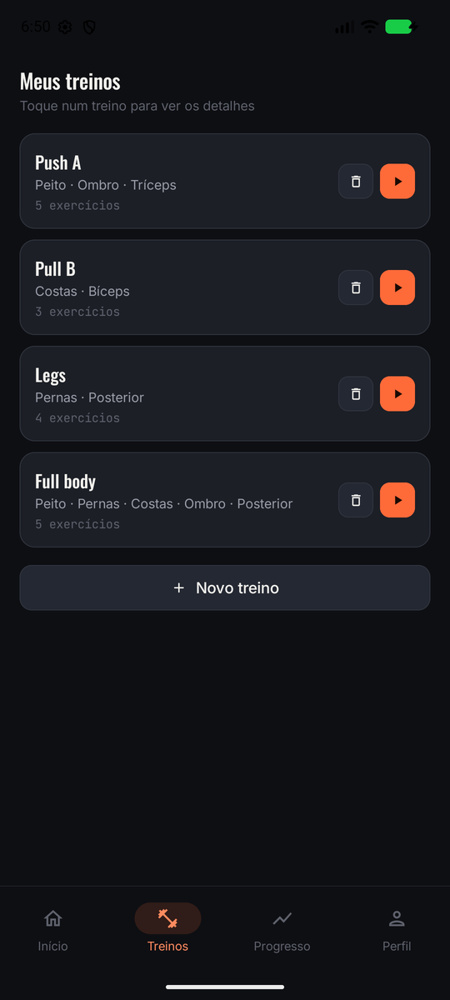 | 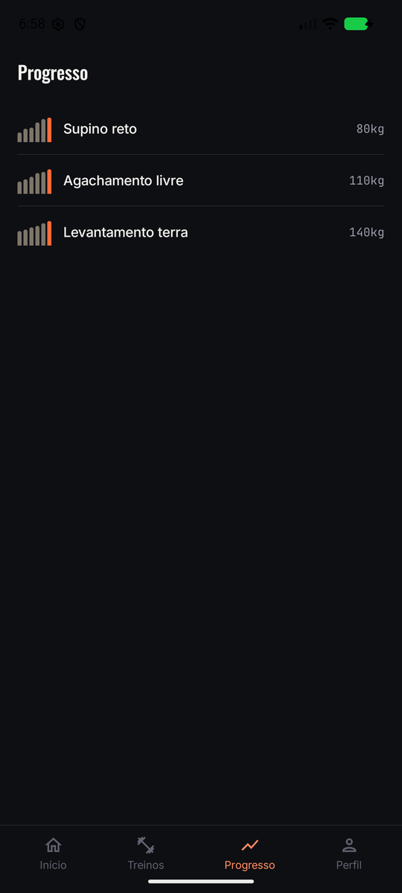 | 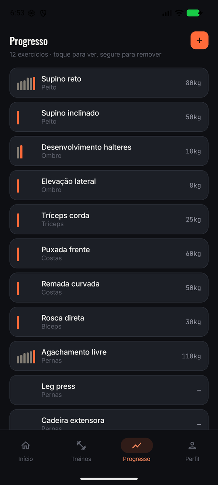 |

| Detalhe · T1 | Detalhe · T2 | Perfil · T1 | Perfil · T2 |
|---|---|---|---|
| 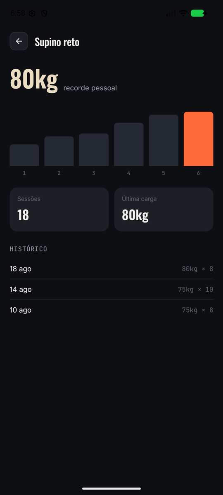 | 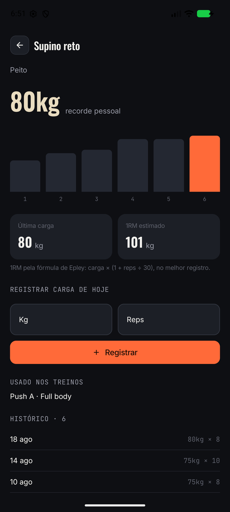 | 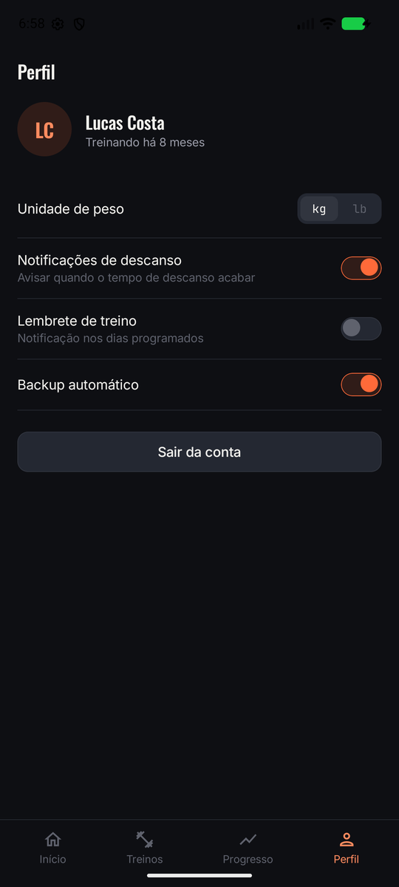 | 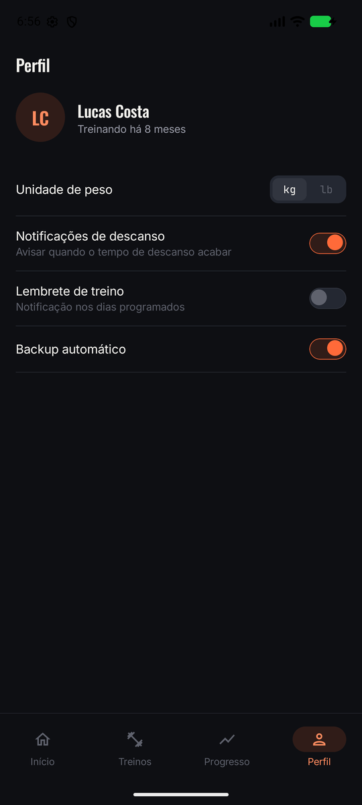 |

O que mudou:

1. **Dados de verdade.** Treinos e exercícios viraram duas listas `mutableStateListOf`. Tudo o que
   se adiciona, remove ou edita aparece na hora em todas as telas que leem aquela lista.
2. **As duas listas se relacionam.** Um treino guarda os ids dos seus exercícios. Por isso o
   catálogo de Novo treino é a própria lista de Progresso: um exercício criado lá já aparece como opção.
3. **Componentes do Material no lugar dos feitos à mão:** `NavigationBar` + `NavigationBarItem`,
   `TopAppBar`, `Card`, `OutlinedTextField` e `AlertDialog`, todos com as cores do tema do protótipo.
4. **Nenhum botão sem propósito.** O lápis de Treinos virou lixeira (a edição agora acontece no
   detalhe), o card inteiro abre o detalhe, e o "Sair da conta" foi retirado porque o app não tem login.
5. **O Treino ativo usa os exercícios do treino escolhido**, com a última carga registrada de cada um.

---

## 2. As telas novas e por que escolhemos elas

| Tela | Rota | O que faz | Situação |
|---|---|---|---|
| Início | `home` | Resumo da semana e atalho para o treino do dia | igual ao T1 |
| Meus treinos | `workouts` | **Lista 1.** Card abre o detalhe, lixeira remove, play inicia | evoluída |
| Detalhe do treino | `workouts/{templateId}` | Exercícios do treino, duração e volume estimados, iniciar | **nova** |
| Novo treino | `create` | **Formulário da lista 1:** nome, exercícios, observações | evoluída |
| Treino ativo | `active/{templateId}` | Séries do treino escolhido, cronômetro, descanso | evoluída |
| Progresso | `progress` | **Lista 2.** Formulário de novo exercício; toque longo remove | evoluída |
| Detalhe do exercício | `progress/{exerciseId}` | Recorde, gráfico, 1RM, registrar carga, treinos que usam | evoluída |
| Perfil | `profile` | Preferências | igual ao T1, sem o botão morto |

**Por que essas duas listas.** No tema do app, os dois tipos de item que realmente existem são o
**treino** (a ficha: Push A, Legs…) e o **exercício** (Supino reto, Agachamento…). Um treino é
feito de exercícios, então a relação entre as duas data classes já vem do próprio domínio — não
precisamos inventar uma "categoria" só para cumprir o requisito. Essa relação foi o que abriu
espaço para os detalhes fazerem mais do que reexibir campos (seção 4).

**Por que a tela nova é o Detalhe do treino.** Era o único item sem tela própria. No T1, tocar
num treino não levava a lugar nenhum, e o lápis abria um formulário vazio.

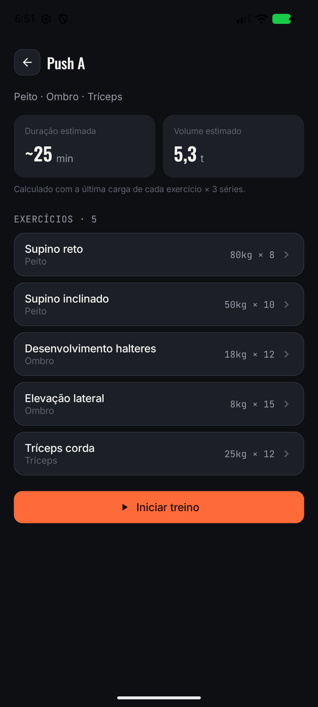 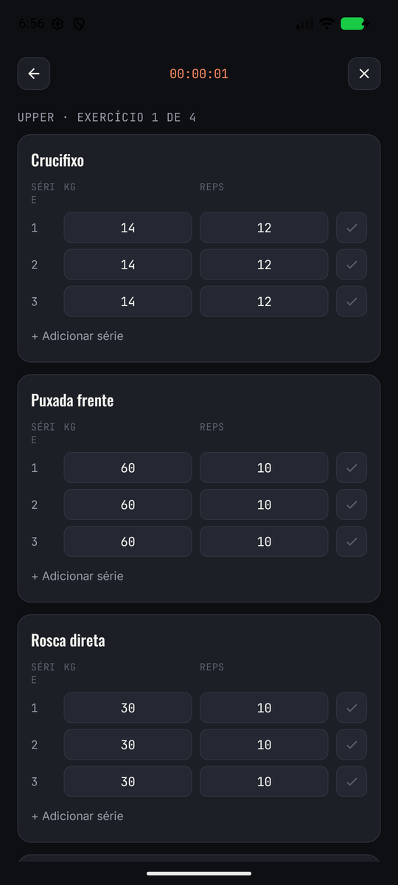

---

## 3. Decisões de organização do código

**Rotas num objeto só.** `Rotas.kt` tem todas as rotas como `const val String`. As rotas com
argumento têm uma função que monta o caminho, para ninguém escrever `"workouts/" + id` espalhado
pelo código:

```kotlin
const val WORKOUT_DETAIL = "workouts/{$ARG_TEMPLATE_ID}"
fun workoutDetail(templateId: String) = "workouts/$templateId"
```

**Um `NavHost` central.** Fica em `AppNavigation.kt`, dentro do único `Scaffold` externo do app.
A `NavigationBar` aparece só nas 4 rotas de aba (`Rotas.TAB_ROUTES`). As telas de tela cheia
(formulário, detalhes, treino ativo) escondem a barra e usam o botão de voltar.
A troca de aba usa `popUpTo` + `saveState`/`restoreState`, assim cada aba lembra onde estava.
As telas não recebem o `navController`: recebem lambdas como `onOpenTemplate(id)`, e só o
`NavHost` sabe para onde cada uma vai. Isso também permite que cada tela tenha um `@Preview`.

**Onde ficaram as listas.** As duas `mutableStateListOf` moram em `FakeRepository`, um `object`.
Pensamos em deixá-las no ViewModel de cada tela de lista, como no exercício de aula, mas a mesma
lista é lida e alterada por 4 telas. A lista de exercícios, por exemplo, é usada por Progresso,
pelo detalhe do exercício, pelo Novo treino, pelo detalhe do treino e pelo Treino ativo. Dentro
de um ViewModel, a lista sumiria ao sair da tela e as outras telas não a enxergariam.

**Detalhe recebe só o id.** A rota leva o id; o detalhe busca o item na lista (`exerciseById`,
`templateById`). Como a busca acontece durante a composição, o detalhe sempre mostra a versão
atual do item — inclusive logo depois de registrar uma carga nele.

**Treino guarda ids, não cópias.** `WorkoutTemplate.exerciseIds` aponta para a lista de exercícios.
O texto "Peito · Ombro · Tríceps" e a contagem de exercícios do card são calculados na hora.
Assim, quando um exercício é removido, ele sai automaticamente dos treinos que o usavam.

**Componentes compartilhados.** Mantivemos a regra do T1: um componente só vai para `ui/components/`
quando duas ou mais telas o usam. Entraram três: `GymTopBar`, `GymTextField` e `ConfirmRemoveDialog`.

---

## 4. A complexidade extra nos detalhes

Os dois detalhes vão além de reexibir o item.

### Detalhe do treino — junta as duas listas, faz cálculos e abre outras telas

- **Combina as listas:** cada exercício do treino aparece com nome, grupo muscular e última carga,
  e todos esses dados vêm da lista de exercícios.
- **Informação calculada:** *duração estimada* (exercícios × 3 séries × ~100 s) e *volume estimado*
  (soma de `última carga × reps × 3` de cada exercício).
- **Navegação secundária:** tocar num exercício abre o Detalhe do exercício, e "Iniciar treino"
  abre o Treino ativo com aqueles exercícios.

### Detalhe do exercício — edita o item ali mesmo e recalcula tudo

- **Registrar carga de hoje:** formulário com dois campos numéricos e validação. A carga nova entra
  no topo do histórico, e o recorde, o gráfico das últimas 6 cargas e o **1RM estimado** (fórmula
  de Epley: `carga × (1 + reps ÷ 30)`) mudam na hora.
- **Usado nos treinos:** lista os treinos que contêm o exercício (dado da outra lista).

| Validação | Antes de registrar | Depois de registrar 85 kg × 6 |
|---|---|---|
| 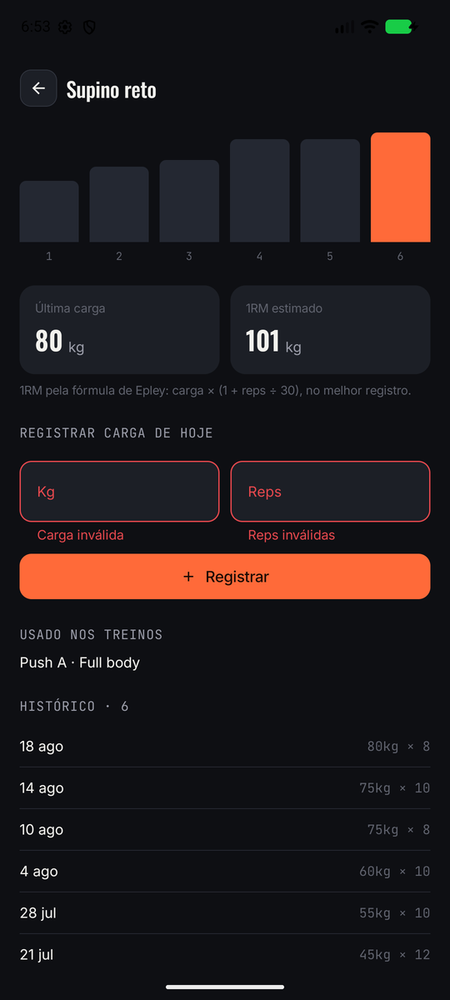 |  | 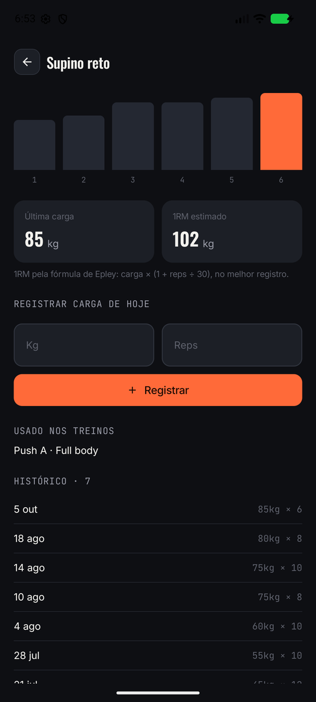 |

**Por que essa escolha.** Num app de academia, o que importa é a evolução da carga. Registrar a
carga é a ação mais comum, então ela precisava estar no detalhe do exercício, não escondida num
formulário à parte. Ela também mostra os dados atravessando telas: depois de registrar 85 kg × 6
no Supino reto, voltar ao Push A mostra o volume estimado recalculado com a carga nova.

---

## 5. Dificuldades e como resolvemos

- **Cores que não obedeciam.** Os estilos de texto do tema (`GymType`) já trazem uma cor. Por isso
  os rótulos da `NavigationBar` ficavam brancos mesmo sem estar selecionados, e o texto de erro do
  `OutlinedTextField` não ficava vermelho. A solução foi passar o estilo com
  `copy(color = Color.Unspecified)`, para valer a cor que o componente escolhe em cada estado.
- **Espaço em dobro no topo.** O `Scaffold` externo já desconta a barra de status. Com a
  `TopAppBar` dentro de outro `Scaffold`, o espaço era descontado duas vezes. Resolvemos zerando os
  insets (`windowInsets = WindowInsets(0, 0, 0, 0)` na barra e `contentWindowInsets` no `Scaffold` interno).
- **Toque longo num `Card`.** O `Card(onClick = …)` não tem `onLongClick`. Usamos um `Card` sem
  `onClick` com `Modifier.combinedClickable(onClick, onLongClick)`.
- **Remover um exercício que está dentro de treinos.** Precisávamos escolher entre bloquear a remoção
  ou tirar o exercício dos treinos também. Escolhemos tirar, e o diálogo de confirmação avisa disso.
  Na implementação, percorremos a lista de treinos por índice, porque alterar uma
  `SnapshotStateList` enquanto um iterador a percorre pode lançar exceção.
- **Detalhe desatualizado.** No T1, o ViewModel do detalhe copiava os dados do item uma vez, no
  `init`. Ao registrar uma carga, a tela não mudava. Trocamos as cópias por *getters*
  (`val exercise get() = FakeRepository.exerciseById(id)`), que são lidos durante a composição.

> ✏️ _Completar com as dificuldades de cada integrante, com as palavras do trio._

---

## Galeria: os fluxos pedidos, passo a passo

**Lista 1 — Treinos: adicionar, ver detalhe e remover**

| Formulário vazio | Preenchido | Adicionado à lista | Detalhe do treino novo | Confirmar remoção | Removido |
|---|---|---|---|---|---|
| 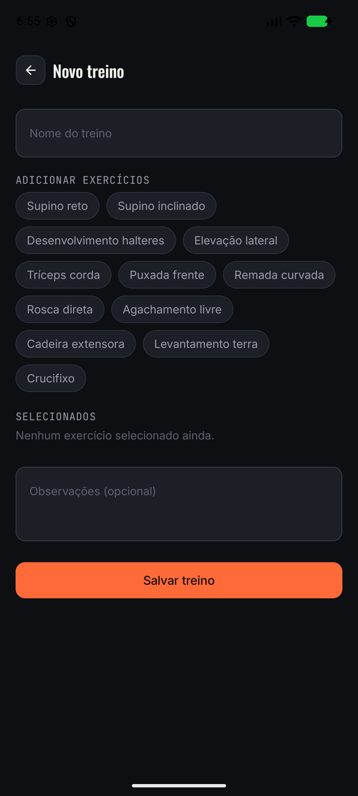 | 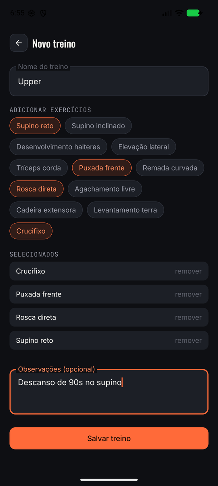 | 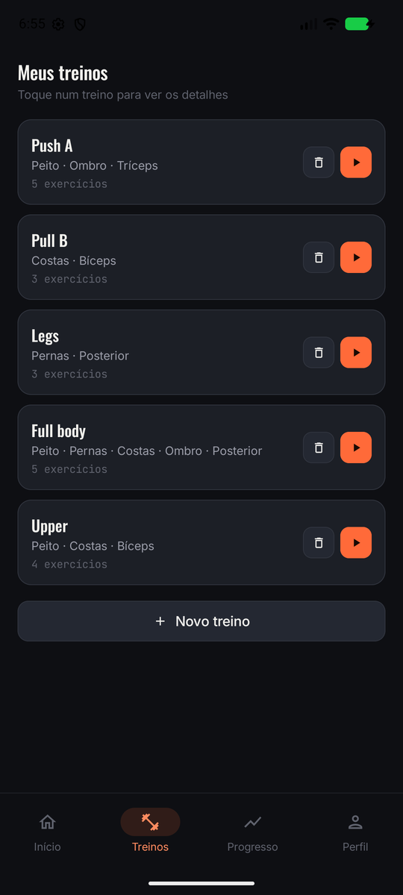 | 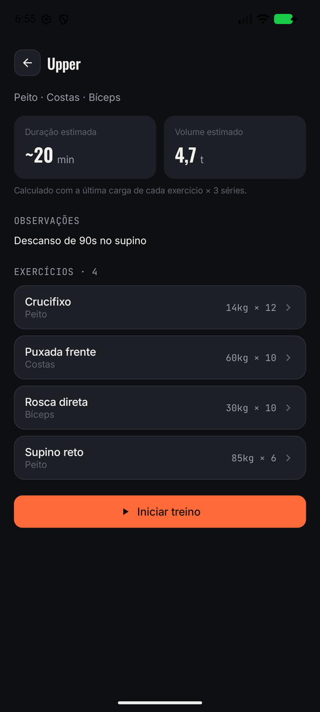 | 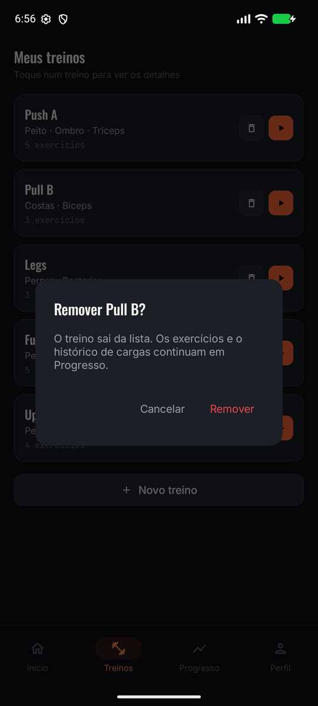 | 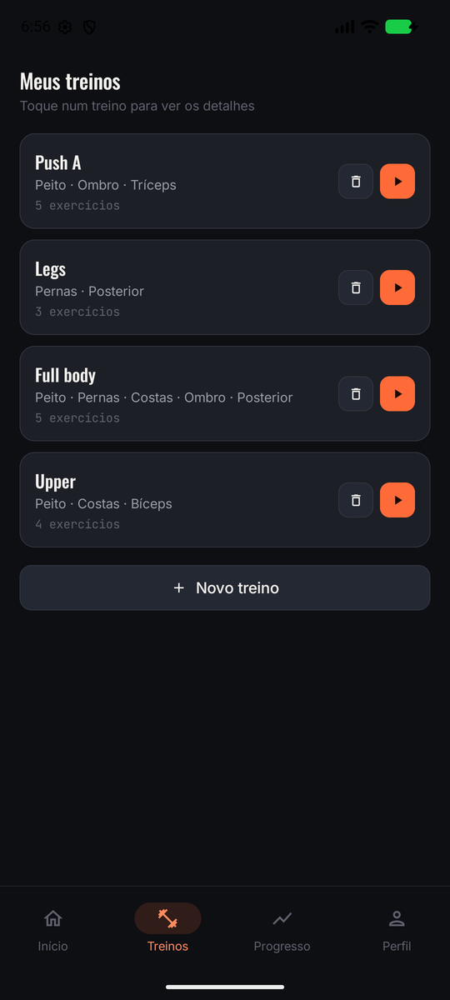 |

**Lista 2 — Exercícios: adicionar e remover**

| Validação | Preenchido | Adicionado (fim da lista) | Toque longo → remover |
|---|---|---|---|
| 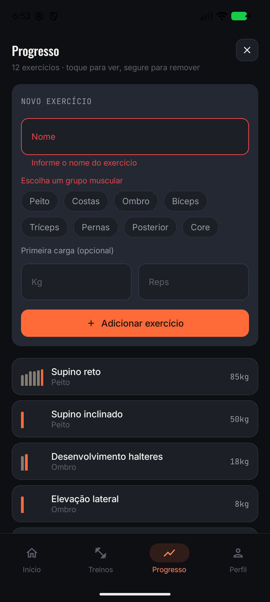 | 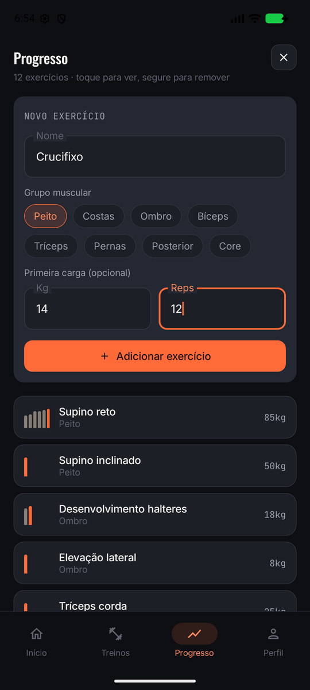 | 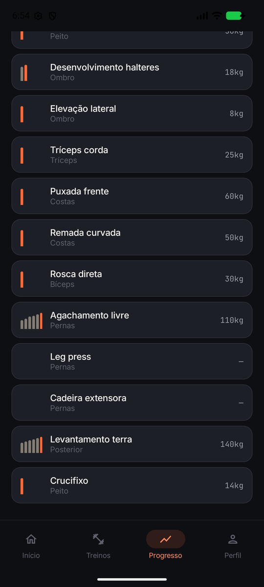 | 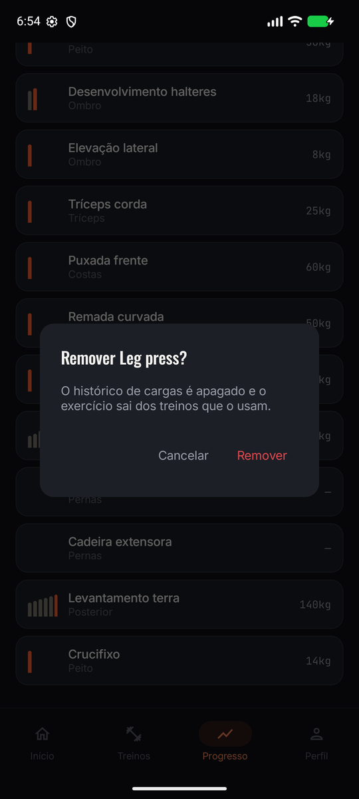 |

O exercício "Crucifixo", criado na Lista 2, aparece como opção no formulário da Lista 1 e entra no
treino "Upper". Ao remover "Leg press", o treino Legs passa de 4 para 3 exercícios.

---

## Roteiro da apresentação

1. **Barra inferior:** passar pelas 4 abas.
2. **Treinos → Push A:** mostrar o detalhe (duração, volume, exercícios).
3. **Supino reto** (dentro do detalhe): registrar 85 kg × 6 e ver recorde, gráfico e 1RM mudarem.
   Voltar e mostrar que o volume do Push A mudou.
4. **Progresso → +:** criar "Crucifixo" (Peito, 14 kg × 12). Ele aparece no fim da lista.
5. **Treinos → Novo treino:** criar "Upper" usando o Crucifixo. Ele aparece na lista.
6. **Lixeira** num treino e **toque longo** num exercício para remover.
7. **Play** num treino: o Treino ativo abre com os exercícios dele.

Os dados vivem só na memória: fechar o app volta tudo ao estado inicial. Isso fica para o próximo trabalho.
