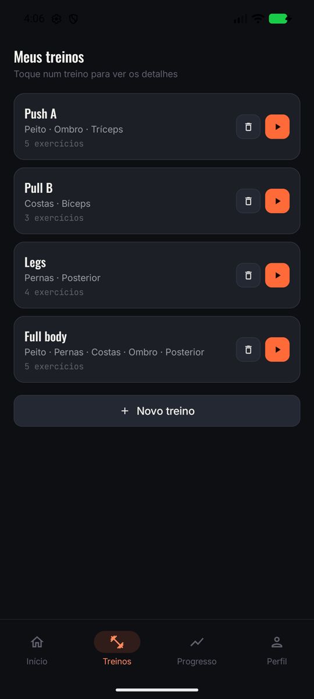
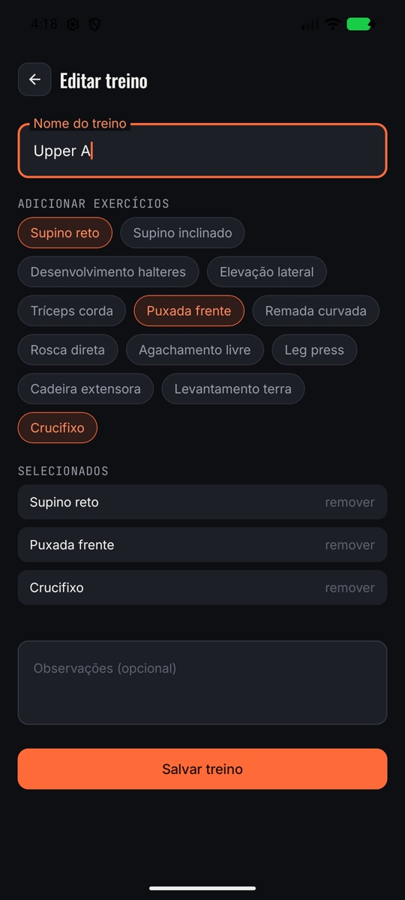
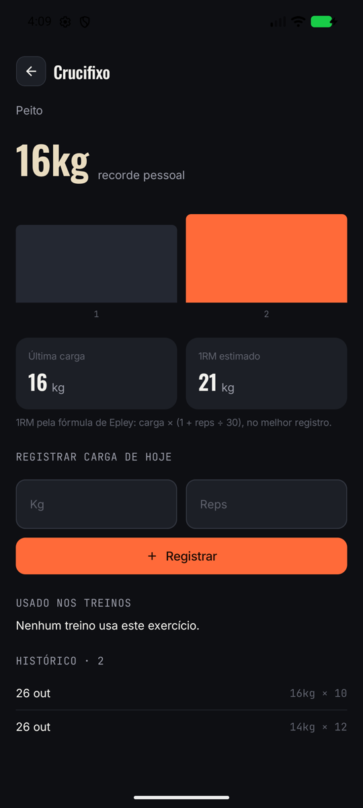
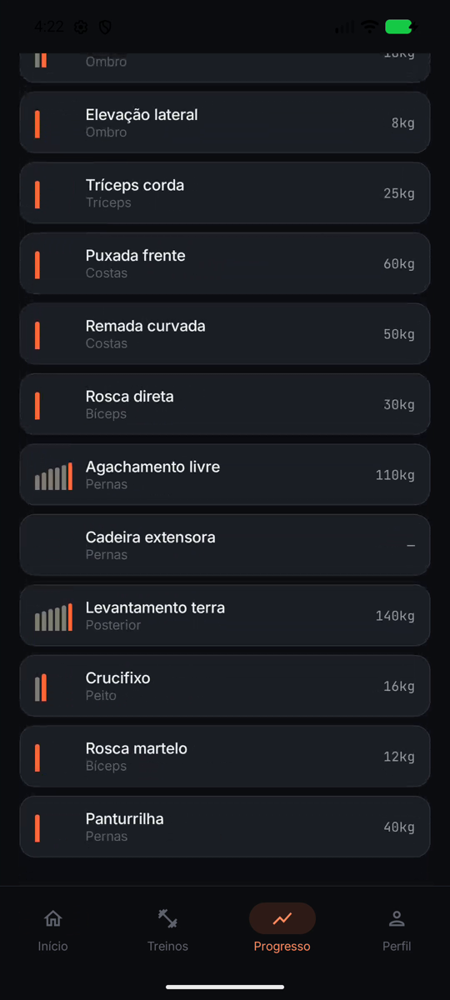

# Gym — app de treino

App Android nativo para acompanhar treinos de academia: montar fichas, executar
a sessão marcando séries com timer de descanso, e acompanhar a evolução de carga
por exercício.

**Trabalho 3 — Persistência com Room.** As duas listas do app — treinos e
exercícios — agora são duas tabelas num banco SQLite local, acessado pelo Room.
Adicionar, editar e remover gravam no banco, e os detalhes buscam o item pelo id.
Fechar o app e abrir de novo mantém tudo. Não há servidor, API nem login: o
banco fica só no aparelho.

📄 **[DOCUMENTACAO-T3.md](DOCUMENTACAO-T3.md)** — Trabalho 3: decisões do trio, prints e
▶ [vídeo do teste de persistência](docs/videos/t3-teste-persistencia.mp4).

   

As telas são a portabilidade de um protótipo clicável em HTML/CSS/JS
(`prototipo-app-treino.html`), com fidelidade visual alta: as cores, fontes e
medidas são traduções literais do CSS original, não aproximações do Material 3.

## Stack

| | |
|---|---|
| Linguagem | Kotlin 2.0.21 |
| UI | Jetpack Compose + Material3 (Compose BOM 2024.10.01) |
| Navegação | Navigation Compose 2.8.4 |
| Persistência | Room 2.6.1 (KSP 2.0.21-1.0.28), banco `gym.db` com as tabelas `treinos` e `exercicios` |
| Estado | ViewModel por tela; listas buscadas do banco num `LaunchedEffect(Unit)` |
| Build | AGP 8.7.2, Gradle 8.9 |
| SDK | `compileSdk` 35 · `targetSdk` 35 · `minSdk` 24 |
| Java | 17 |

Tema **dark-only**, sem `dynamicColor` — o protótipo não tem variante clara.

## Como rodar

Requer Android Studio (Ladybug ou mais recente) e JDK 17.

1. **Open** no Android Studio, apontando para a raiz do projeto (a pasta com
   `settings.gradle.kts`, não `app/`).
2. Deixe o Gradle Sync terminar. Na primeira vez ele baixa o Android SDK.
3. Crie um emulador em **Tools → Device Manager → + → Create Virtual Device**
   (Pixel 7, imagem de sistema API 35), ou conecte um aparelho com Depuração USB
   ativada.
4. Rode com **▶** (`Shift+F10`).

Pela linha de comando:

```bash
./gradlew installDebug   # compila e instala no dispositivo conectado
./gradlew assembleDebug  # só gera o APK
```

Só o Perfil tem `@Preview`. As outras telas leem o banco e não têm, porque o
ViewModel delas precisa do `Application` para abrir o Room, e o painel de Preview
não tem um.

**Banco de dados.** Na primeira abertura, o banco nasce com 4 treinos e 12
exercícios de exemplo. Para voltar a esse estado, apague os dados do app
(Configurações → Apps → Gym → Armazenamento → Limpar dados). Para ver as tabelas
com o app rodando: **View → Tool Windows → App Inspection → Database Inspector**.
Os erros de banco aparecem no Logcat com a tag `GymDb`.

## Telas

| Tela | Rota | Arquivo | O que faz |
|---|---|---|---|
| Início | `home` | `feature/home/` | Saudação, sequência e volume da semana, treino do dia (o primeiro de Meus treinos, lido do banco), últimos treinos |
| Meus treinos | `workouts` | `feature/workouts/WorkoutsScreen.kt` | **Lista 1.** Card abre o detalhe; lixeira remove; play inicia |
| Detalhe do treino | `workouts/{templateId}` | `feature/workouts/WorkoutDetailScreen.kt` | Busca o treino por id no banco; exercícios, duração e volume estimados; lápis edita; iniciar |
| Novo treino | `create` | `feature/create/` | Formulário: nome, exercícios em chips, observações → `inserir` |
| Editar treino | `edit/{templateId}` | `feature/create/` | O mesmo formulário, preenchido com o treino do banco → `atualizar` |
| Treino ativo | `active/{templateId}` | `feature/active/` | Séries do treino escolhido (kg/reps), marcar concluída, cronômetro |
| Descanso | — | `feature/active/RestOverlay.kt` | Sobreposição com anel de progresso, ±15s, pular |
| Progresso | `progress` | `feature/progress/ProgressScreen.kt` | **Lista 2.** Exercícios com sparkline e recorde; **+** abre o formulário; toque longo remove |
| Detalhe do exercício | `progress/{exerciseId}` | `feature/progress/ProgressDetailScreen.kt` | Busca o exercício por id no banco; recorde, gráfico, 1RM estimado, registrar carga (`atualizar`), treinos que usam |
| Perfil | `profile` | `feature/profile/` | Unidade de peso, notificações, backup |

A `NavigationBar` de 4 abas aparece só em Início, Treinos, Progresso e Perfil.
As outras telas ocupam a tela inteira e têm botão de voltar (`TopAppBar` ou
cabeçalho próprio, ambos com `navController.popBackStack()`).

## Estrutura

```
app/src/main/
├── res/font/                 9 TTFs estáticos (Oswald, Inter, JetBrains Mono)
├── res/values/               strings.xml, themes.xml
└── java/com/example/gymmobile/
    ├── MainActivity.kt       hospeda GymTheme + GymApp
    ├── ui/theme/             Color · Type · Shape · Theme
    ├── ui/components/        componentes usados por 2+ telas
    ├── data/                 Models.kt (as 2 @Entity), os 2 @Dao, AppDatabase (Singleton + conversores + dados iniciais), FakeRepository.kt (exemplos e textos fixos)
    ├── navigation/           Rotas, AppNavigation (NavHost), GymBottomBar
    └── feature/<tela>/       Screen.kt + ViewModel.kt por tela
```

Regra de organização: um componente só sobe para `ui/components/` quando é usado
por duas ou mais telas. Componente de uma tela só mora no pacote dela.

## Design tokens

O bloco `:root` do CSS do protótipo virou `ui/theme/Color.kt`, com as cores
que o app usa, mais `Danger` (erro de formulário e remoção), que o protótipo não tinha. Os estilos de texto em `ui/theme/Type.kt` são nomeados pelo papel que
cumprem (`display22`, `sectionLabel`, `mono12`) em vez da escala genérica do
Material (`bodyLarge`), para que a correspondência com o CSS continue rastreável.

Convenções obrigatórias ao mexer na UI:

- Cores só via `GymColors` — nada de `Color(0xFF...)` fora de `Color.kt`
- Tipografia só via `GymType` — nada de `MaterialTheme.typography.*`
- Bordas de `0.5.dp` (o protótipo usa `0.5px`)
- Separador entre termos é `·` (U+00B7), nunca hífen

As fontes são TTFs estáticos empacotados no APK, um por peso. O repositório
`google/fonts` publica apenas fontes variáveis, que em `minSdk 24` não aplicam o
eixo de peso — Oswald 400 e 700 sairiam idênticas.

## Fora de escopo por enquanto

- Servidor, API, sincronização na nuvem e autenticação — o banco é só local
- Testes automatizados
- Tema claro
- Notificações reais — os interruptores do Perfil mudam apenas o estado da tela

## Documentação

- [`DOCUMENTACAO-T3.md`](DOCUMENTACAO-T3.md) — Trabalho 3: Room, decisões, prints e vídeo
- [`DOCUMENTACAO.md`](DOCUMENTACAO.md) — Trabalho 2: o que mudou desde o T1, decisões e prints
- `docs/prints/` — capturas do app (`t1-*` = Trabalho 1, `t2-*` = Trabalho 2, `t3-*` = Trabalho 3)
- `docs/videos/` — vídeo do teste de persistência (Trabalho 3)
- `docs/superpowers/specs/` — design do Trabalho 1, com o mapeamento CSS → Compose
- `docs/superpowers/plans/` — plano de implementação do Trabalho 1, tarefa a tarefa
